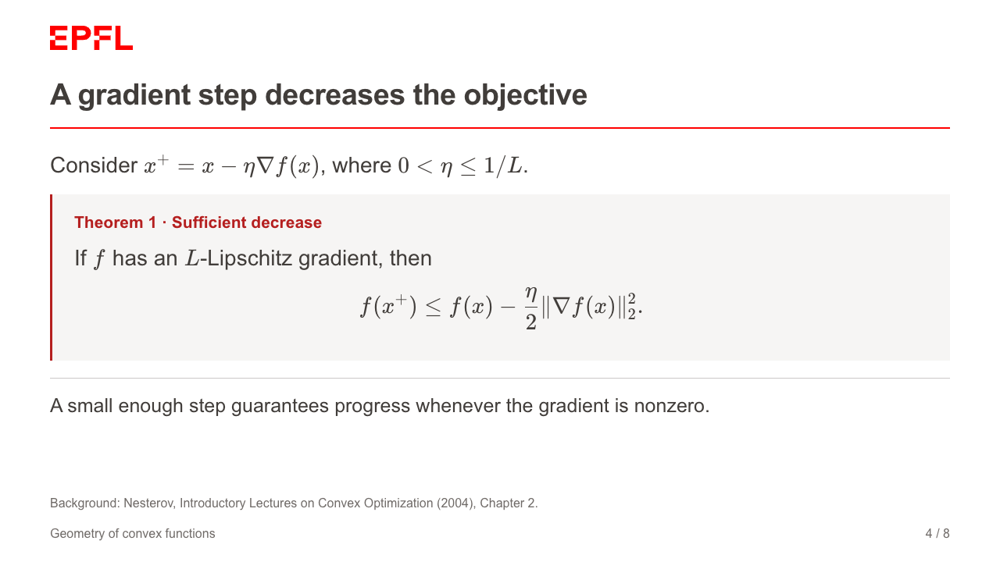

# EPFL theme for Colloquium

A minimal, reusable theme for mathematical talks: white slides, Arial text,
charcoal headings, an official EPFL vector logo, and a thin red rule. The
mathematical showcase connects convexity, gradient descent, and concentration.

The theme targets balanced slides: a theorem or three to five derivation lines
with short explanations. Definitions, lemmas, propositions, assumptions,
remarks, and proofs use labelled Markdown callouts. Statements are upright;
numbers and names are supplied by the author.

This is an **unofficial theme**, not an EPFL Communications product.



## Build the showcase

Requirements: Python 3.10+, [uv](https://docs.astral.sh/uv/), and Git. Install a
Chromium-based browser such as Google Chrome for PDF export. No Node.js or LaTeX
installation is needed. Installation initially requires internet access;
generated HTML includes its images, KaTeX, and math fonts and opens offline.

```sh
uv sync --locked
make build
make export
```

Open `output/epfl-math-showcase.html` directly, or run `make serve` and visit
<http://localhost:8091/epfl-math-showcase.html>.
The eight-slide PDF is `output/epfl-math-showcase.pdf`.

Arrow keys navigate. Right/Space reveals the next step; `F` enters fullscreen.
Click the slide number to open the slide picker. PDF export includes every
reveal. Speaker notes remain in the source and HTML metadata; this pinned
Colloquium version does not supply a presenter-note pane.

## Use the theme in another project

Install this repository as a package, locally or from its Git repository:

```sh
uv pip install /path/to/colloquium-theme-epfl
epfl-slides slides.md -o output/talk.html --pdf
```

Alternatively, add the local theme as a project dependency:

```sh
uv add /path/to/colloquium-theme-epfl
uv run epfl-slides slides.md -o output/talk.html
```

Copy `examples/starter.md` as a starting point. Images are resolved relative to
the source Markdown file, including when building from another directory.

The Python interface is:

```python
from colloquium_theme_epfl import build_epfl

build_epfl("slides.md", "output/talk.html")
```

Use `epfl-slides` rather than `colloquium build` to apply branding, callouts, and
offline assets. Colloquium's upstream `theme:` selector does not load external
theme packages. This wrapper uses its public parser and HTML builder and leaves
the installed engine untouched.

## Repository layout

- `src/colloquium_theme_epfl/theme/`: reusable CSS and vector logo.
- `src/colloquium_theme_epfl/vendor/katex/`: KaTeX 0.18.10 and WOFF2 fonts.
- `examples/`: starter, eight-slide mathematical showcase, and editable SVG.
- `docs/authoring.md`: layout, callouts, equations, reveals, and customization.
- `docs/design.md`: design specification and references.
- `tests/`: portable builder integration checks.
- `output/`: generated HTML/PDF; ignored by Git.

The Python package includes the CSS, logo, and vendored math assets, so consumers
do not depend on the repository layout. Colloquium is pinned to revision
`f9c6c85974d020e3de50538629f8dcf280a4dc0b`; `uv.lock` captures the environment.

## Scope and checks

The supported canvas is 16:9 (1280 × 720). Supported content includes prose,
mathematics, images/SVG, tables, bibliography citations, columns, notes, and
reveals. For offline reliability, download remote images first; use SVG or
images instead of Chart.js canvases or remote iframes. Equations retain the
author's chosen size, so split overly long equations rather than relying on
automatic shrinking. Source/reference links still require internet to visit.

Run `make test` for builder checks. Review browser and PDF previews whenever you
change slide content. Initial layout and offline verification are recorded in
`docs/verification.md`.

## Rights and sources

Original theme code and documentation are MIT-licensed; see `LICENSE`.
The EPFL name and logo remain EPFL's property and are excluded from that license.
KaTeX is MIT-licensed, with its license bundled alongside the runtime.
