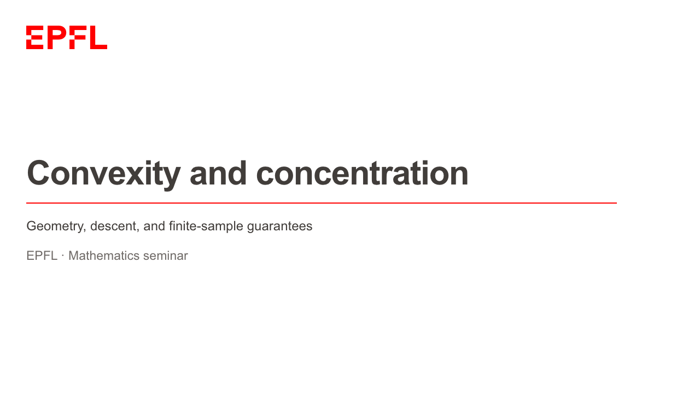
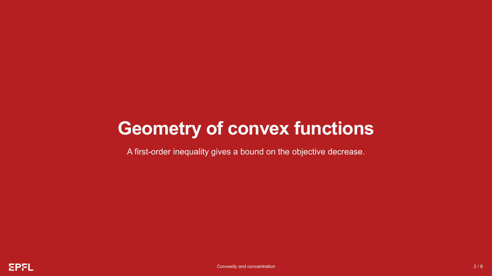
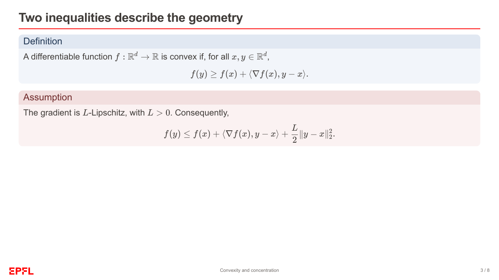
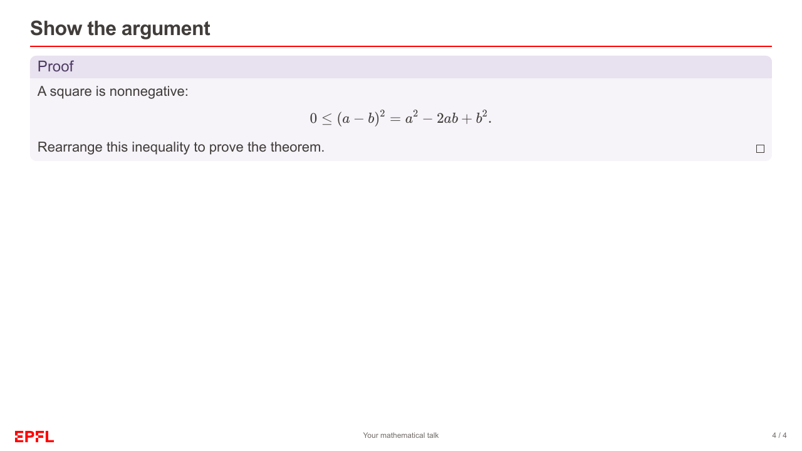
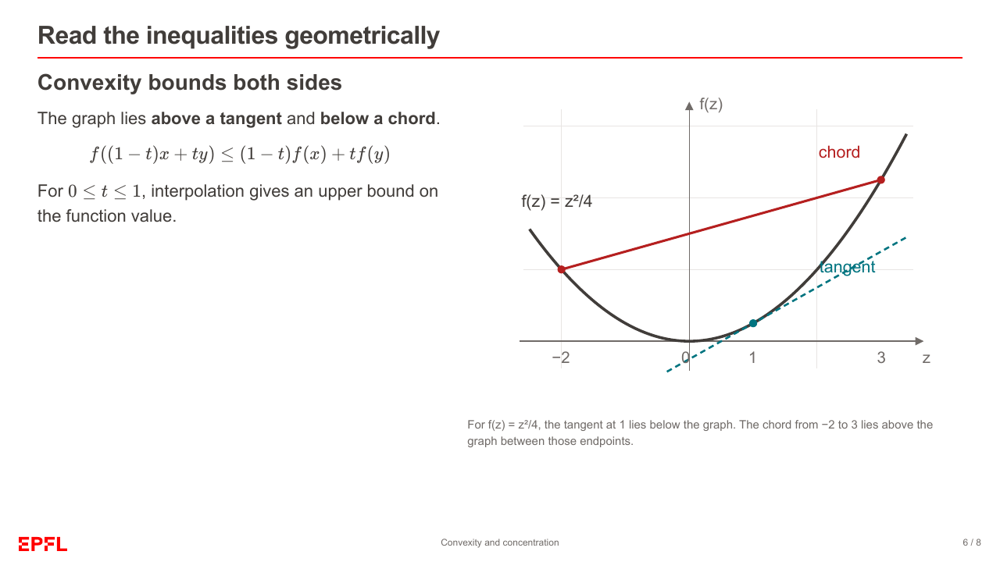
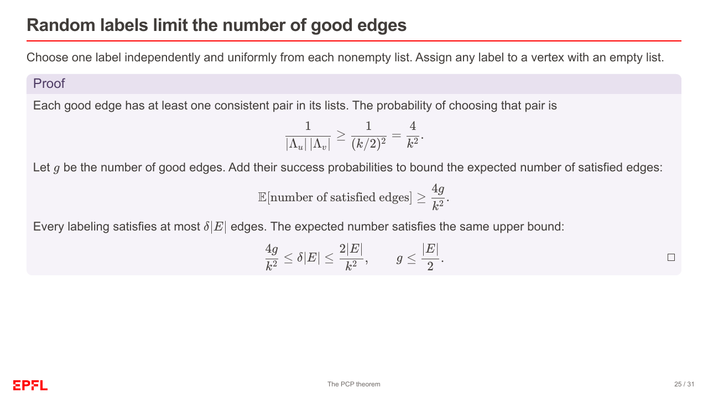

# EPFL Slides in Colloquium

This is an **unofficial project**, not affiliated with EPFL.

 

 

 


(ai generated text below)

---

## Install and start

Install these tools:

- Python 3.10 or later.
- [uv](https://docs.astral.sh/uv/).
- Git.
- Make for the shortcut commands below.
- A Chromium-based browser, such as Google Chrome, for PDF export.

You do not need Node.js or LaTeX.

From the repository directory:

```sh
uv sync --locked
make starter
```

Open `output/epfl-starter.html` in a browser.
To start your own talk, copy [examples/starter.md](examples/starter.md) to `slides.md`.
Build your slides with this command:

```sh
uv run --locked epfl-slides slides.md -o output/talk.html --pdf
```

Omit `--pdf` to build HTML only. You need internet access to install the package.
Each HTML file contains its images, KaTeX, and math fonts and opens offline.
You still need internet access to open links to external references.

## Example decks

| Example | Slides | HTML | HTML and PDF |
| --- | --- | --- | --- |
| [Starter](examples/starter.md) | 4 | `make starter` | `make export-starter` |
| [Convexity and concentration](examples/showcase.md) | 8 | `make build` | `make export` |
| [The PCP theorem](examples/pcp-showcase.md) | 31 | `make pcp` | `make export-pcp` |

The commands write files to `output/` with `.html` and `.pdf` extensions.
The file names are `epfl-starter`, `epfl-math-showcase`, and `epfl-pcp-showcase`.
`make serve` builds and serves the short math showcase at
<http://localhost:8091/epfl-math-showcase.html>.

The short showcase covers convexity, gradient descent, and concentration.
The PCP showcase follows gap 3-SAT, two-prover games, Label Cover, and Set Cover
hardness. The slides and speaker notes state the construction assumptions.

Use these controls during a presentation:

- Use the arrow keys to navigate.
- Press Right or Space to reveal the next step.
- Press `F` to enter fullscreen mode.
- Click the slide number to open the slide picker.

PDF export shows all content, including each reveal step.
Speaker notes remain in the Markdown source and HTML metadata.
The pinned engine version does not provide a pane for speaker notes.

## Author and customize

Use ordinary Markdown and Colloquium directives.
Native fenced `box` elements contain a title, a color (`tone`), and indented Markdown content.
Choose blue, green, red, or purple for the color.

````markdown
```box
title: Theorem
tone: blue
content: |
  For all $a,b\in\mathbb R$,

  $$ 2ab\le a^2+b^2. $$
```
````

Use standard box titles such as Definition, Theorem, or Proof. End a Proof
box with `$\square$` to place the QED symbol on its right side.
The symbol stays inside the box.
Colloquium already supports math in slide content.
EPFL Slides also enables math in native boxes and controls their appearance.

Frontmatter is the YAML configuration block at the start of a Markdown file.
Set `fonts` and `custom_css` in frontmatter to customize the design.
The package does not include Suisse Int’l. Install it locally to use that font.

## Use from another project

Install the local repository into an activated virtual environment:

```sh
uv pip install /path/to/colloquium-theme-epfl
epfl-slides slides.md -o output/talk.html --pdf
```

For a uv-managed project, use:

```sh
uv add /path/to/colloquium-theme-epfl
uv run epfl-slides slides.md -o output/talk.html
```

The Python interface is:

```python
from colloquium_theme_epfl import build_epfl

build_epfl("slides.md", "output/talk.html")
```

Image paths are relative to the Markdown source file.
The package includes its CSS, logo, and math assets.
You can use it outside this repository.

Build with `epfl-slides`. This package uses Colloquium's parser and builder,
then adds branding and embeds assets in the HTML. It also adds math rendering
inside boxes and QED placement. It does not modify the installed engine.
The pinned engine does not discover external theme packages through `theme:`.
Setting `theme: epfl` with `colloquium build` does not enable these features.

## Check and develop

```sh
make test
make build
make starter
make pcp
uv build
```

Review HTML and PDF output after changing content or styles. Check equations,
reveals, and spacing around footnotes and footers.
`make clean` removes the six standard example HTML/PDF files.
It preserves other files in `output/`.

Repository layout:

- `src/colloquium_theme_epfl/`: builder, CLI, theme CSS, logo, and vendored KaTeX.
- `examples/`: three Markdown decks, an editable SVG diagram, and README previews.
- `tests/`: builder integration checks.
- `output/`: generated files, ignored by Git.

The package requires Colloquium revision `f9c6c85974d020e3de50538629f8dcf280a4dc0b`.
The `uv.lock` file records the dependencies.
The package includes KaTeX 0.18.10 and its WOFF2 fonts for offline use.

## Rights and sources

The MIT license covers the original project code and documentation. See [LICENSE](LICENSE).
The EPFL name and logo remain EPFL's property. The project license does not cover them.
KaTeX uses the MIT license. The package includes that license alongside the KaTeX runtime.
