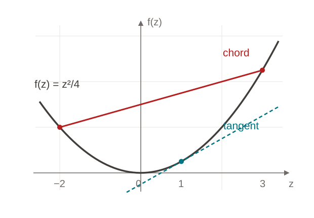

<!-- layout: title-left -->

# Convexity and concentration

Geometry, descent, and finite-sample guarantees

EPFL · Mathematics seminar 3 October 2026

<!-- notes: A short mathematical talk that demonstrates the EPFL theme. The examples connect convex geometry, a gradient step, and a finite-sample probability bound. -->

---

<!-- layout: section-break -->

## Geometry of convex functions

From a first-order inequality to a useful descent guarantee.

<!-- notes: Introduce the two ingredients: convexity describes the geometry; smoothness controls the change along a step. -->

---

## Two inequalities describe the geometry

> [!DEFINITION] Definition 1 · Differentiable convexity
>
> A differentiable function $f:\mathbb{R}^d\to\mathbb{R}$ is convex if, for all $x,y\in\mathbb{R}^d$,
>
> $$ f(y) \ge f(x)+\langle\nabla f(x),y-x\rangle. $$

> [!ASSUMPTION] Assumption · Smoothness
>
> The gradient is $L$-Lipschitz, with $L>0$. Consequently,
>
> $$ f(y) \le f(x)+\langle\nabla f(x),y-x\rangle+\frac L2\|y-x\|_2^2. $$

<!-- notes: The lower bound comes from convexity, while the upper bound comes from smoothness. The next descent result needs smoothness alone. -->

---

## A gradient step decreases the objective

Consider $x^+=x-\eta\nabla f(x)$, where $0<\eta\le 1/L$.

> [!THEOREM] Theorem 1 · Sufficient decrease
>
> If $f$ has an $L$-Lipschitz gradient, then
>
> $$ f(x^+) \le f(x)-\frac{\eta}{2}\|\nabla f(x)\|_2^2. $$

A small enough step guarantees progress whenever the gradient is nonzero.

Background: Nesterov, Introductory Lectures on Convex Optimization (2004), Chapter 2.

<!-- notes: No convexity is required for this one-step result. Convexity becomes important when translating objective decrease into global convergence statements. -->

---

## The proof is one substitution

> [!PROOF] Proof · Let $g=\nabla f(x)$
>
> Apply the smoothness inequality with $y=x-\eta g$:
>
> $$
> \begin{aligned}
> f(x-\eta g)
> &\le f(x)-\eta\|g\|_2^2+\frac{L\eta^2}{2}\|g\|_2^2 \\
> &= f(x)-\eta\left(1-\frac{L\eta}{2}\right)\|g\|_2^2 \\
> &\le f(x)-\frac{\eta}{2}\|g\|_2^2 \\
> &\le f(x).
> \end{aligned}
> $$

<!-- step -->

The key condition is L\eta\le 1. □

<!-- notes: This slide demonstrates an optional reveal. The derivation is visible immediately; the takeaway appears on the next advance. PDF export includes both. -->

---

<!-- columns: 45/55 -->

## Read the inequalities geometrically

### Convexity bounds both sides

The graph lies **above a tangent** and **below a chord**.

$$
f((1-t)x+ty)\le (1-t)f(x)+tf(y)
$$

For $0\le t\le1$, interpolation gives an upper bound on the function value.

|||

For f(z)=z^2/4, compare the tangent at 1 with the chord between −2 and 3.

<!-- notes: The tangent is a lower bound on the entire graph. The chord is an upper bound only on the interval between its endpoints. -->

---

## Finite-sample guarantees for empirical averages

Let $X_1,\ldots,X_n$ be independent, with $X_i\in[0,1]$ almost surely.

$$ \bar X_n=\frac1n\sum_{i=1}^nX_i,\qquad \mu=\frac1n\sum_{i=1}^n\mathbb E[X_i]. $$

> [!PROPOSITION] Proposition 2 · Hoeffding's inequality
>
> For every $\varepsilon>0$, the empirical average satisfies
>
> $$ \mathbb P\!\left(\left|\bar X_n-\mu\right|\ge\varepsilon\right)\le 2\exp(-2n\varepsilon^2). $$

For failure probability $\delta\in(0,1)$, it suffices to take $n\ge\log(2/\delta)/(2\varepsilon^2)$.

Hoeffding (1963), Probability inequalities for sums of bounded random variables, Theorem 2.

<!-- notes: This is the layout stress test: a long heading, sums with subscripts, expectation, tall delimiters, and a probability bound. The variables need not have identical distributions. The sufficient sample size makes the failure probability at most delta. -->

---

## References and further reading

<ol class="epfl-reference-list">
<li>Yurii Nesterov (2004). <em>Introductory Lectures on Convex Optimization: A Basic Course.</em> Springer. <a href="https://doi.org/10.1007/978-1-4419-8853-9">doi:10.1007/978-1-4419-8853-9</a></li>
<li>Wassily Hoeffding (1963). <em>Probability inequalities for sums of bounded random variables.</em> Journal of the American Statistical Association, 58(301), 13–30. <a href="https://doi.org/10.1080/01621459.1963.10500830">doi:10.1080/01621459.1963.10500830</a></li>
</ol>

Convexity supplies geometry; smoothness supplies descent; concentration supplies finite-sample control.

<!-- notes: References use normal hyperlinks. The slides and equations themselves remain available offline. -->
